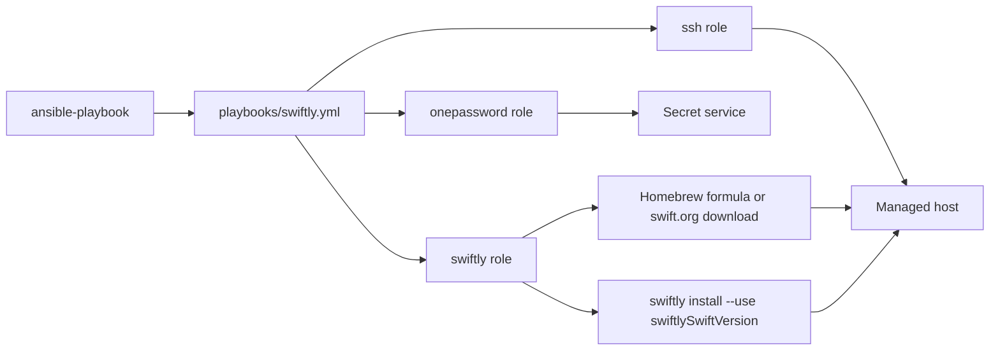
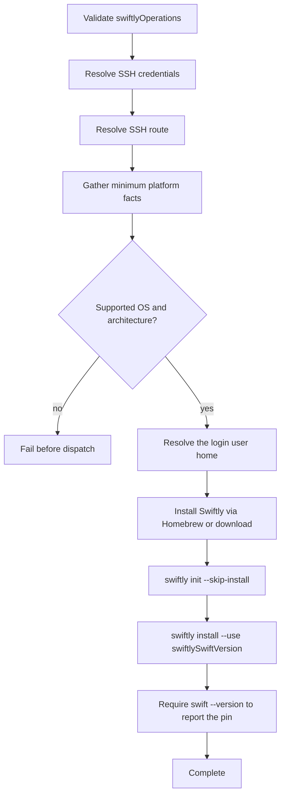

# Swiftly

## Scope

[`playbooks/swiftly.yml`](../../playbooks/swiftly.yml) and
[`roles/swiftly`](../../roles/swiftly) install Swiftly (the Swift toolchain
manager) and install plus select a pinned Swift toolchain through the ordered,
non-empty `swiftlyOperations` array.

| Operation | Result |
| --- | --- |
| `install` | Install Swiftly, initialize it for the login user, install and select the `swiftlySwiftVersion` toolchain, and validate `swift --version`. |

Swiftly manages the toolchain per user. Every Swiftly task runs as the login
user (`become: false`), so the toolchain installs under that user's home, not
`/root`.

### Supported Hosts

| OS family | Architectures |
| --- | --- |
| `Darwin` | `x86_64`, `arm64` |
| `Debian` | `x86_64`, `aarch64` |

The values match Ansible facts exactly. Darwin uses the Homebrew formula; Debian
downloads the official `swiftly-<architecture>.tar.gz` bootstrap from
`download.swift.org` and extracts it. Unsupported combinations fail before
dispatch.

## Goal

Use this domain to establish a pinned, validated Swift toolchain on a supported
workstation through Swiftly.

## Invocation

```bash
ansible-playbook playbooks/swiftly.yml -i '<target>,' -b \
  -e onePasswordVault='<vault>' \
  -e '{"swiftlyOperations":["install"]}'
```

## Architecture



## Workflow



## Variables

Put the pinned version in downstream `group_vars/` or `host_vars/`, and the
operation array in runtime `-e`.

| Variable | Type | Source | Default / required | Purpose |
| --- | --- | --- | --- | --- |
| `swiftlyOperations` | `array[enum]`: `install` | Runtime `-e` | Required; role default is `[]` | Ordered operations to execute. |
| `swiftlySwiftVersion` | `string` (`6.3.3` or `6.3`) | Role default, `group_vars`, `host_vars`, or runtime `-e` | `6.3.3` | Swift toolchain version Swiftly installs and selects. |
| `onePasswordVault` | `string` | Role default, inventory, or runtime `-e` | Configured default is redacted | Coordinate for shared SSH credential resolution. |

See the [variable schema](../../.schema/ansible-vars.schema.json).

## Usage

```bash
ansible-playbook playbooks/swiftly.yml -i '<target>,' -b \
  -e onePasswordVault='<vault>' \
  -e '{"swiftlyOperations":["install"]}'
```

Pin a different version in downstream inventory:

```yaml
swiftlySwiftVersion: "6.3"
```

## Verification

- [Installer contract tests](../../tests/test_application_installers.py) verify
  operation dispatch, platform facts, schemas, and layering.
- [Molecule scenario](../../roles/swiftly/molecule/default) covers the Ubuntu
  download path: `make test-molecule-swiftly`.
- No Swiftly e2e HIL procedure exists under [`hil-test/`](../../hil-test); the
  Darwin/Homebrew path remains an explicit verification gap and is checked
  manually by running the playbook against a macOS host.
